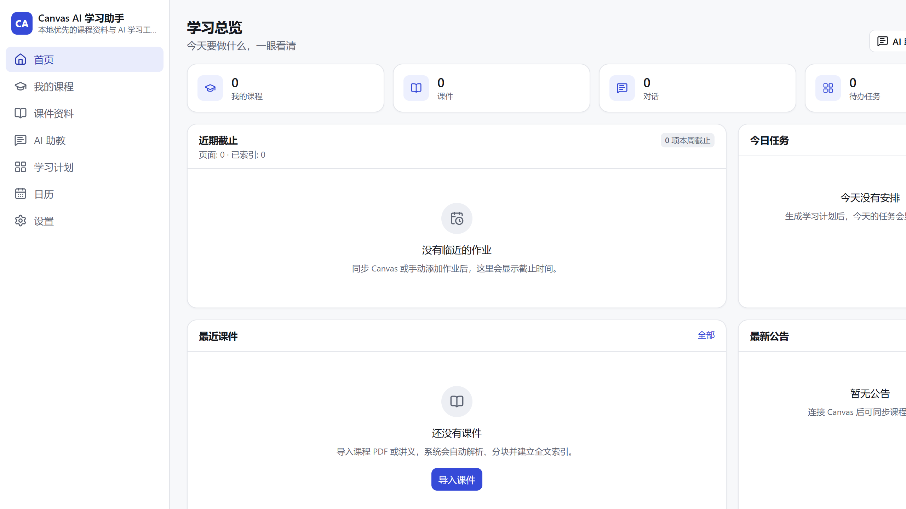
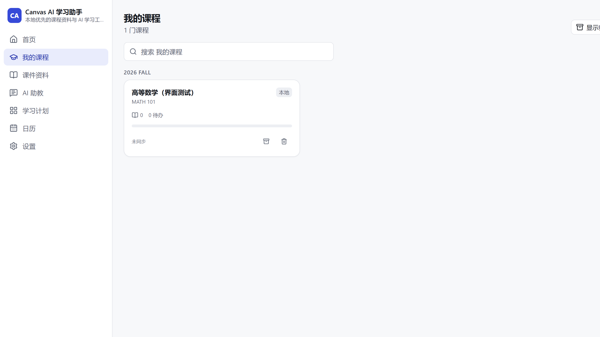
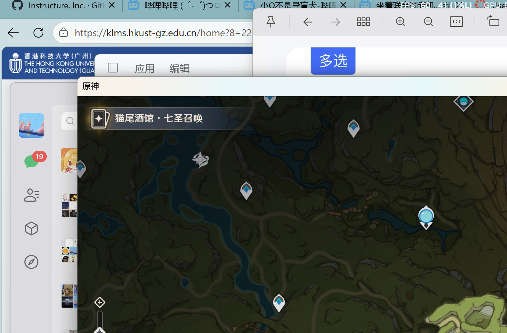

# Canvas AI 学习助手 · Canvas AI Learning Assistant

面向 **HKUST(GZ) Canvas**（`https://hkust-gz.instructure.com`）的本地优先 AI 学习工作台，
支持 **Windows 桌面端** 与 **Android 移动端**（Tauri 2 + React 19 + Rust）。

导入课程课件 → 本地解析分块索引 → 基于原文提问 → **带真实页码引用的回答** → 点击引用跳转 → 生成可执行的学习计划。

> 本仓库中的每一项功能状态都以「是否真实运行并得到有效数据」为准。
> 未验证的能力会明确标注为「未测试」，不会伪装成已完成。详见
> [docs/implementation-status.md](docs/implementation-status.md)。

---

## 1. 核心特性

| 模块 | 能力 |
| --- | --- |
| 课程管理 | 手动创建课程 / 从 Canvas 同步课程，章节、作业、公告、成绩、讨论、课程页面 |
| 课件库 | 导入 PDF / PPTX / DOCX / TXT / Markdown / 图片 / ICS / CSV / JSON / ZIP，SHA-256 去重 |
| 文档解析 | 自研 PDF 内容流解析（`ToUnicode` CMap）、PPTX / DOCX XML 解析、扫描件识别 |
| 检索 | SQLite FTS5（BM25）+ 可选向量检索（余弦相似度），RRF 融合，中文按 bigram 分词 |
| AI 问答 | 任意 OpenAI 兼容接口；流式输出；证据以 `<课件证据>` 包裹；只保留模型真实引用的来源 |
| 引用跳转 | PDF 显示真实页码、PPTX 显示真实幻灯片号；DOCX/文本只显示章节，**不编造页码** |
| 学习计划 | 确定性调度算法（AI 只建议内容，不决定时间表），支持锁定、重排、完成度跟踪 |
| 日历 | 月视图 + 议程，ICS 导入/导出，作业截止自动进入日历 |
| Canvas | 独立窗口网页登录（含 SSO/MFA），同源 fetch 读取数据，能力状态逐项实测 |
| 安全 | API Key 存 Windows 凭据管理器 / Android Keystore；不读取、不复制 Cookie |
| 国际化 | 简体中文 / English，浅色 / 深色 / 跟随系统 |

---

## 2. 界面速览

Windows 桌面端（浅色主题，首页）：



课程列表（通过界面真实创建课程，数据写入本地 SQLite）：



首次启动引导页确认了 WebView2 渲染、主题变量、`zh` 文案与路由：



> 以上截图来自本机真实运行的可执行程序，通过 WebView2 远程调试协议采集，
> 场景记录见 [docs/testing.md](docs/testing.md)。

---

## 3. 快速开始（开发模式）

前置：Node.js ≥ 20、pnpm、Rust 1.88+、平台 WebView 运行时。

```powershell
# Windows 一键准备工具链（Rust + MinGW-w64 + 环境变量）
powershell -ExecutionPolicy Bypass -File scripts/install-toolchain.ps1

# 每次进入新终端后先加载环境
. .\scripts\env.ps1

pnpm install
pnpm tauri:dev          # 启动桌面开发版
```

详细的工具链、交叉编译与常见问题见
[docs/development.md](docs/development.md)。

---

## 4. 构建产物

| 目标 | 命令 | 产物 |
| --- | --- | --- |
| Windows 安装包 | `pnpm tauri:build` | `src-tauri/target/release/bundle/nsis/*.exe` |
| Android APK | `pnpm tauri:android -- --apk` | `src-tauri/gen/android/app/build/outputs/apk/**/*.apk` |

说明与签名配置见 [docs/build-windows.md](docs/build-windows.md) 与
[docs/build-android.md](docs/build-android.md)。

---

## 5. Canvas 集成原则（重要）

本项目**只**通过学校官方 Canvas 网页登录获得身份：

- 不使用 Personal Access Token、不使用 OAuth、不使用开发者密钥；
- 不读取浏览器 Cookie、不把会话复制到 Rust HTTP 客户端；
- 不绕过 CORS / CSRF / SSO / MFA，不关闭同源策略；
- 登录状态由**可验证的页面行为**确认（真实数据请求成功），而不是「HTTP 200」或「发生跳转」；
- 网页登录成功 **不等于** 获得独立 Canvas API Token —— 因此所有数据获取都在页面内同源执行。

实现细节：[docs/canvas-web-login.md](docs/canvas-web-login.md)；
能力矩阵与实测结果：[docs/canvas-capabilities.md](docs/canvas-capabilities.md)。

> Canvas 相关的端到端验证需要真实的学校账号。当前开发环境没有可用凭据，
> 因此 Canvas 能力一律保持「未测试 / 需登录」，不会标记为 supported。

---

## 6. 安全与隐私

- 课程、课件、对话、计划全部保存在本机 SQLite，不上传任何云端存储；
- AI API Key 只写入系统凭据存储（Windows Credential Manager / Android Keystore），
  数据库不存明文，界面不回显；
- Canvas 页面无法访问 API Key：远程窗口没有授予以应用命令能力；
- 检索到的课件片段才会进入提示词，且每个课件有独立的「允许发送到 AI」开关；
- 详见 [docs/security.md](docs/security.md)。

---

## 7. 仓库结构

```
.
├── src/                      # React 前端（Windows 与 Android 共用）
│   ├── app/                  # 路由
│   ├── components/           # UI 组件与布局
│   ├── pages/                # 各功能页面
│   ├── services/             # Tauri 命令封装、事件订阅
│   ├── stores/               # 设置 / 提示
│   ├── i18n/                 # 中英文文案
│   └── tests/                # 前端测试与 setup
├── src-tauri/                # Rust 后端
│   ├── src/                  # 命令、领域、存储、解析、检索、AI、计划、集成
│   ├── migrations/           # SQLite schema
│   ├── tests/                # 集成测试
│   └── gen/android/          # Tauri 生成的 Android 工程（含 Keystore 助手）
├── docs/                     # 中文文档
├── scripts/                  # 工具链安装、构建、冒烟脚本
└── fixtures/                 # 真实 PDF 测试数据（LaTeX 源码 + 产物）
```

架构与数据流：[docs/architecture.md](docs/architecture.md)；
数据库模型：[docs/data-model.md](docs/data-model.md)。

---

## 8. 测试

```powershell
. .\scripts\env.ps1
cd src-tauri; cargo test          # 185 单元测试 + 15 集成测试（含真实 PDF 与 AI 传输）
cd ..; npx vitest run             # 13 个前端测试（工具函数 + 中英文案一致性）
npx tsc --noEmit                  # 类型检查

# 一条命令跑完全部门禁
powershell -File scripts/verify.ps1
# 产物验收：安装→运行→卸载 + APK 内容/签名
powershell -File scripts/verify-artifacts.ps1
```

测试覆盖范围、已验证内容与未覆盖内容见 [docs/testing.md](docs/testing.md)。

---

## 9. 构建产物

| 产物 | 大小 | 说明 |
| --- | --- | --- |
| Windows 安装包 | 4.93 MiB | `artifacts/Canvas AI Learning Assistant_0.1.0_x64-setup.exe`，已实测安装 → 运行 → 卸载 |
| Android APK | 31.48 MiB | `artifacts/Canvas-AI-Learning-Assistant-0.1.0-arm64-x86_64.apk`，含 arm64-v8a + x86_64，已签名（临时开发密钥） |

> APK 使用临时开发密钥签名，仅用于验证可安装性；正式分发请用自己的 keystore 重新签名，
> 见 [docs/build-android.md](docs/build-android.md)。

---

## 10. 已知限制

1. **Canvas 未做端到端实测**：缺少学校账号，能力状态为「未测试」。
2. **Canvas 文件正文不自动下载**：下载需要页面内的临时令牌，无法在不提取 Cookie 的前提下
   由 Rust 端发起；应用只同步文件元数据，正文请用「手动导入」。
3. **AI 未用真实密钥联调**：需要在设置页填入自己的 API Key 后才能验证流式回答。
4. **Android APK 已构建并签名，但未在真机/模拟器上运行**：构建环境未安装 AVD 系统镜像。
5. **扫描版 PDF 无 OCR**：仅标记「需要视觉识别」，需配置视觉模型才能理解图片内容。
6. **PDF 解析为自研精简实现**：覆盖常见学术 PDF；复杂排版（多栏、加密、特殊 CID 字体）
   可能退化，缺失文本时会明确提示。已用真实 LaTeX 中英文 PDF 验证分页与 CJK 提取。

---

## 11. 许可证

MIT，见 [LICENSE](LICENSE)。
